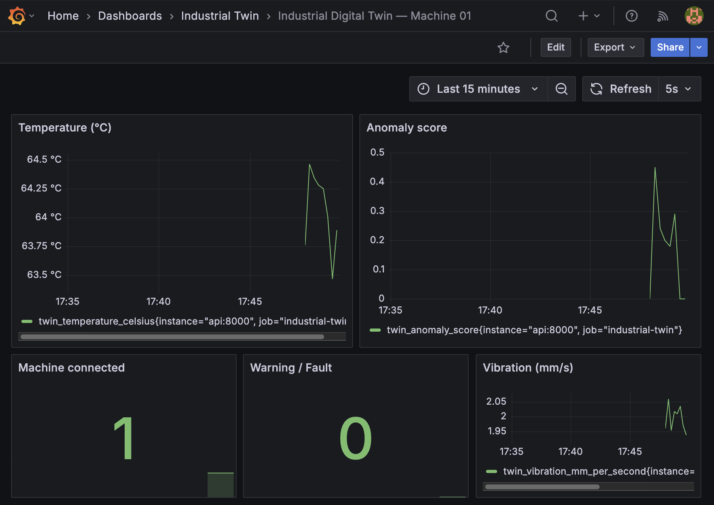
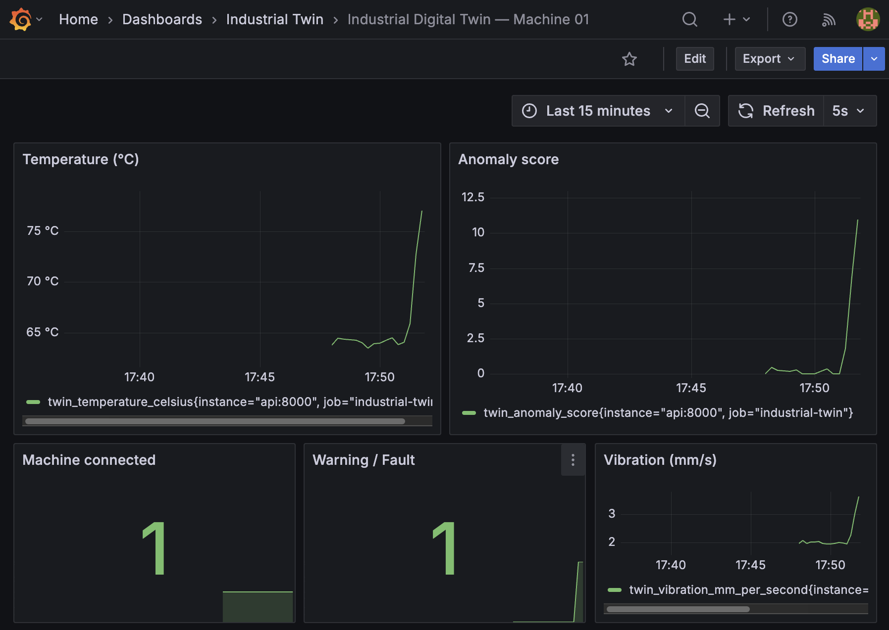

# Smart Industrial Digital Twin — One Machine

A small local project that simulates one industrial machine. It sends temperature and vibration readings through MQTT, calculates machine health, stores the latest digital-twin state, and displays it through an API and Grafana.

> A healthy machine gradually heats up and vibrates more; its digital twin changes from `HEALTHY` to `WARNING` to `FAULT` and exposes the reason via an API.

## See it in Grafana

The dashboard makes the change from a healthy machine to a fault immediately visible.

| Healthy machine | Degrading machine |
|---|---|
| Temperature and vibration stay near their baseline. **Warning / Fault = 0**. | Temperature, vibration, and anomaly score rise. **Warning / Fault = 1**. |
|  |  |

## Architecture

```text
Python machine simulator
   │ temperature, vibration every 2 s
   ▼
Eclipse Mosquitto (MQTT pub/sub)
   │ factory/line1/machine01/telemetry
   ▼
Python worker → validation + anomaly scoring
   │
   ▼
Redis (latest machine twin, baseline, last 60 samples, event count)
   │
   ├── FastAPI /twin and /alerts
   │
   └── FastAPI /metrics → Prometheus → Grafana (optional)

Docker Compose first → local Kubernetes using kind second
```

## Prerequisites

- Docker Desktop (or Docker Engine + Compose plugin)
- A terminal and VS Code
- For Kubernetes only: [`kind`](https://kind.sigs.k8s.io/) and [`kubectl`](https://kubernetes.io/docs/tasks/tools/)
- Python 3.12+ only if running tests outside Docker

## Run it step by step

```bash
# 1. Start the MQTT broker and database
docker compose up -d mosquitto redis

# 2. Start the MQTT consumer
docker compose up -d consumer

# 3. Start the healthy machine simulator
docker compose up -d simulator

# 4. Start the API
docker compose up -d api

# Confirm what is running
docker compose ps
```

Watch messages being sent and processed:

```bash
docker compose logs -f simulator consumer
```

Check the digital twin:

```bash
curl http://localhost:8000/twin
curl http://localhost:8000/alerts
```

The first 10 readings calibrate the healthy baseline. The expected state is:

```text
CALIBRATING → HEALTHY
```

To start everything at once instead:

```bash
docker compose up --build -d
```

Open **http://localhost:8000/docs** to explore the API interactively.

`/twin` returns 404 until the first telemetry event arrives. This is expected.

### Observe the machine degrade

```bash
# Important: stop the original publisher before switching scenarios.
docker compose stop simulator
# Reset only the local demo's Redis DB so the baseline is recalibrated.
docker compose exec redis redis-cli FLUSHDB
SCENARIO=degrading docker compose up -d --force-recreate simulator
```

On Windows PowerShell, replace the final command with:

```powershell
$env:SCENARIO="degrading"; docker compose up -d --force-recreate simulator
```

Observe `GET /twin`: `CALIBRATING → HEALTHY → WARNING → FAULT`. On a fresh run, detection starts after enough healthy samples establish a baseline. You can switch back using `SCENARIO=healthy` and the same reset steps.

## Optional dashboard — Grafana

```bash
docker compose --profile observability up -d prometheus grafana
```

- Grafana: **http://localhost:3000** (`admin` / `admin` on your laptop only)
- Prometheus: **http://localhost:9090**
- Grafana dashboard is pre-provisioned under the **Industrial Twin** folder.
- Prometheus scrapes the FastAPI `/metrics` endpoint every three seconds.

Grafana is optional; the complete digital twin works without it. Credentials and unauthenticated MQTT in this demo are not suitable for a public or real OT deployment.

## API

| Endpoint | Description |
|---|---|
| `GET /health` | API process health |
| `GET /ready` | Redis connectivity check |
| `GET /twin` | Latest measured state and derived machine health |
| `GET /alerts` | Current warning or fault, if any |
| `GET /metrics` | Machine-health metrics in Prometheus format |

Example `/twin` response (illustrative):

```json
{
  "machine_id": "machine01",
  "reported_mode": "RUNNING",
  "temperature_c": 73.8,
  "vibration_mm_s": 3.2,
  "health": "WARNING",
  "anomaly_score": 3.1,
  "reason": "Elevated temperature or vibration",
  "connectivity": "ONLINE",
  "last_seen": "2026-11-04T11:00:00+00:00",
  "seconds_since_last_event": 1.2,
  "processed_events": 24
}
```

## How the anomaly detector works

The simulated machine emits temperatures around 64°C and vibration around 2 mm/s. The first **10 healthy samples** define a fixed baseline. We compare each subsequent measurement to the baseline using a positive z-score (higher-than-normal values), with minimum standard deviations to avoid sensitivity to noise.

- Score below **2.5** = `HEALTHY`
- Score **2.5–3.99** = `WARNING`
- Score **4+** = `FAULT`

During `degrading` mode, temperature and vibration drift upward only after the healthy calibration period. This is **statistical anomaly detection**, not a trained predictive-maintenance model. Thresholds are fictional demonstration values.

## Local Kubernetes with kind

After Compose works, run:

```bash
kind create cluster --name industrial-twin
docker build -t industrial-twin:local .
kind load docker-image industrial-twin:local --name industrial-twin
kubectl apply -f k8s/all.yaml
kubectl rollout status deployment/twin-api --timeout=120s
kubectl get pods
kubectl port-forward svc/twin-api 8001:8000
```

Then browse **http://localhost:8001/twin** or **http://localhost:8001/docs**.

The Kubernetes simulator runs the `degrading` scenario by default. The kind stack intentionally excludes Prometheus/Grafana to keep the orchestration demo small. You can show independent API replicas with:

```bash
kubectl scale deployment/twin-api --replicas=2
kubectl get pods -l app=twin-api
```

All API replicas read the same Redis state. Do **not** scale the simulator or the single subscriber without redesigning publisher IDs and event-processing guarantees.

Clean up with `kind delete cluster --name industrial-twin`.

**Note:** The Kubernetes broker and Redis are ephemeral, and the MQTT config is intentionally unsecured for a local demo. This is not a production-ready industrial deployment.

## Tests

```bash
python -m venv .venv
# macOS/Linux: source .venv/bin/activate
# Windows PowerShell: .venv\\Scripts\\Activate.ps1
pip install -r requirements-dev.txt
python -m pytest -q
```

Tests cover calibration, anomaly detection, simulator degradation, freshness, and FastAPI responses (with an isolated Redis stub). See [`docs/DEMO.md`](docs/DEMO.md) for a five-minute walkthrough and [`docs/ARCHITECTURE.md`](docs/ARCHITECTURE.md) for architecture decisions and limitations.

## Project map

```text
app/           FastAPI, data models, anomaly rules
simulator/     Single MQTT publisher (healthy/degrading)
worker/        MQTT subscriber and Redis state updater
mosquitto/     MQTT broker config
tests/         Python unit/API tests
grafana/       Optional auto-provisioned dashboard
prometheus/    Optional Prometheus scraping config
k8s/          Minimal local Kubernetes manifests
docs/         Architecture and demo walkthrough
```
